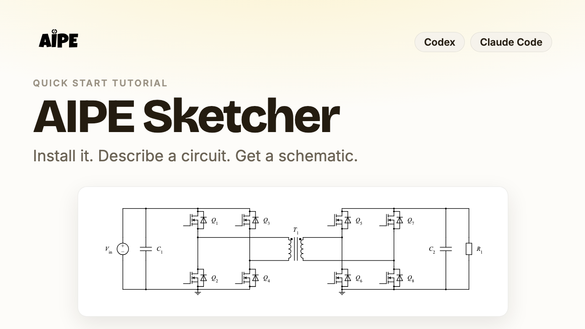

# AIPE Sketcher

AI-powered electrical schematic generation for power electronics and circuit engineering.

## Overview

AIPE Sketcher turns a circuit description into a clean, conventional SVG
schematic and proves that the drawing is electrically faithful to it.

- **You provide** a circuit: a request in plain language to your AI agent, a
  named reference converter (buck, boost, half or full bridge, dual active
  bridge, LLC resonant, three-phase inverter), or explicit Circuit IR JSON
  (components, ports and nets).
- **It produces** an SVG schematic drawn with a standard symbol library, plus
  a JSON report: electrical validation, drawing connectivity read back from the
  wires, layout quality, assumptions and limitations.
- **In the AIPE ecosystem** it is the schematic tool (`aipe.sketch`): it works
  on its own, and can also render circuits carried in an AIPE Core
  Engineering State with hash-linked provenance.

It runs locally on Python 3.9+ with the standard library only. No API key,
cloud service or package installation is needed for the plugin.

## Watch Quick Start Tutorial

<a href="https://github.com/FulongLi/AIPE-Sketcher/releases/download/v0.2.0/AIPE-Sketcher-Quick-Start.mp4"></a>

99 seconds: install AIPE Sketcher in Codex or Claude Code, describe a circuit
in plain English, and get a validated SVG schematic.
[Watch the video](https://github.com/FulongLi/AIPE-Sketcher/releases/download/v0.2.0/AIPE-Sketcher-Quick-Start.mp4) · [storyboard and sources](docs/media/README.md)

## Installation

### OpenAI Codex

```bash
codex plugin marketplace add FulongLi/AIPE-Sketcher
codex plugin add aipe-sketcher@aipe-sketcher
```

Restart Codex (or the ChatGPT desktop app) so the plugin's skill is loaded.

### Anthropic Claude Code

```bash
claude plugin marketplace add FulongLi/AIPE-Sketcher
claude plugin install aipe-sketcher@aipe-sketcher
```

Inside a Claude Code session the same steps are `/plugin marketplace add
FulongLi/AIPE-Sketcher` and `/plugin install aipe-sketcher@aipe-sketcher`.

Both need `python3` (3.9 or newer; `py -3` on Windows) on `PATH`. To use the
command line without an agent: `python3 -m pip install
"git+https://github.com/FulongLi/AIPE-Sketcher"`, then `aipe-sketcher --help`.
Details, local development and updates: [docs/plugins.md](docs/plugins.md).

## Quick Start

Ask your agent:

> Generate a Dual Active Bridge converter schematic using AIPE Sketcher,
> validate all electrical connections, and export the result as SVG.

The skill writes the circuit as Circuit IR, renders it, and reports the
validation results and the assumptions it used (here: the reference DAB has no
separate series inductor). The same result from the command line:

```bash
aipe-sketcher examples dab --ir-only -o schematics
aipe-sketcher render schematics/dab.json -o schematics
```

<p align="center"></p>

Connectivity validation shows that the drawing matches the circuit it was
given. It does not establish component ratings, safety or circuit performance.

## Documentation

| Topic | Document |
| --- | --- |
| Plugin installation, verification and packaging | [docs/plugins.md](docs/plugins.md) |
| Command line, report format and Python API | [docs/cli.md](docs/cli.md) |
| Circuit IR format and modelling conventions | [skills/schematic/references/circuit-ir.md](skills/schematic/references/circuit-ir.md) |
| Architecture, validation and known limits | [docs/architecture.md](docs/architecture.md) |
| Layout rules and drawing metrics | [docs/layout-rules.md](docs/layout-rules.md) |
| Symbol library and registry | [docs/symbol-library.md](docs/symbol-library.md) |
| AIPE Engineering State integration | [docs/engineering-state.md](docs/engineering-state.md) |
| Regression results | [docs/auto-planning-results.md](docs/auto-planning-results.md) |
| Quick Start tutorial video: storyboard, source and verification | [docs/media/README.md](docs/media/README.md) |

## License

Free for personal, non-commercial use. Commercial use requires prior written
permission from the copyright holder. See [LICENSE](LICENSE) (a source-available
licence, not an open-source licence). The bundled symbol sheet is CC0 1.0
material from [UPB-LEA](https://github.com/upb-lea/Inkscape_electric_Symbols);
see [THIRD_PARTY_NOTICES.md](THIRD_PARTY_NOTICES.md).
